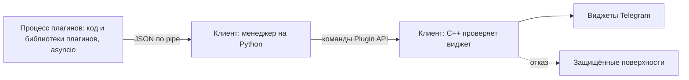

# Защищённые окна и вкладки Ovygram

Статус: **реализовано на Linux 15 ноября 2026 года**, кроме пунктов раздела
«Что не сделано». Ограничения для Windows написаны, но **ни разу не запускались
на Windows**: до прогона там их нельзя считать работающими.

## Что защищается

Ovygram сам создаёт системные поверхности: окно установки плагина, раздел
менеджера плагинов, страницу плагина и подтверждение удаления. Плагин не может
читать и менять их элементы, получать их дескрипторы, перехватывать в них ввод,
перекрашивать их и скрывать их своими поверхностями.

Остальной Telegram открыт Plugin API как раньше: дерево виджетов, свойства,
методы Qt, правила, хуки и собственные окна плагинов.

Это граница между приложением и кодом плагина. Компрометация ОС, другое
привилегированное приложение и действия владельца компьютера в неё не входят.

## Как устроено

1. **Код плагинов не исполняется в процессе клиента.** Менеджер
   (`ovygram_runtime.py`) остаётся во встроенном Python клиента. Он проверяет
   пакет, подпись, целостность и метаданные, хранит установки и настройки.
   Исполнение вынесено в `ovygram_executor.py`, который работает в отдельном
   процессе `ovygram_host.py`. Менеджер передаёт туда уже проверенные байты
   исходника, а не путь к файлу.
2. **Канал** (`ovygram_channel.py`) — JSON-сообщения с длиной по унаследованным
   pipe. Каждая сторона читает другую как недоверенный ввод: превышение размера
   или сообщение неверного вида останавливает процесс плагинов. Клиент
   проверяет вид описания настроек и длину текстов ошибок. Ошибки, команды и
   объявления принимаются только для плагинов, запущенных в этом процессе, а не
   для любого установленного. Текст ошибки, написанный плагином, сводится к
   одному абзацу до 500 символов и показывается в менеджере с пометкой
   «Сообщение плагина».
3. **Один процесс на все плагины.** Плагины не изолированы друг от друга: у них
   общие библиотеки и общий каталог данных.
4. **Библиотеки плагинов** (`dependencies/`) подключаются только к процессу
   плагинов. Клиент из них ничего не импортирует.
5. **Защищённые поверхности** (`ovygram/protected_ui.h`). Поверхность
   регистрируется вызовом `ProtectSurface`. Пока она существует, для неё, её
   содержимого и её контейнеров Plugin API:
   - не выдаёт дескрипторы и не разрешает старые;
   - не сопоставляет селекторы и правила, не доставляет клавиши и клики;
   - не показывает содержимое в `widgets.tree` (контейнеры перечисляются без
     дескриптора, чтобы оставались доступны остальные виджеты окна);
   - не сообщает о её окне через `native.on_window`.
6. **Перекрытие и перекраска.** Пока поверхность существует:
   - палитра плагинов снимается, поверхность рисуется цветами темы
     пользователя, `ui.palette` отклоняется;
   - overlay-холсты на контейнерах поверхности скрываются;
   - в окне с поверхностью отклоняются свойства и методы, которые двигают,
     показывают, скрывают или поднимают виджеты (`geometry`, `visible`,
     `raise`, `show`, `setFocus` и подобные);
   - диалоги плагинов (`ui.show_dialog`) отклоняются, а уже открытые
     закрываются: диалог рисуется поверх всего компонентами Telegram и мог бы
     сойти за окно Ovygram. Поэтому кнопка в настройках плагина не может
     открыть диалог, пока открыта страница плагина.
7. **Окно установки** дополнительно, как и раньше, приостанавливает весь Plugin
   API на время показа.

## Ограничения ОС на Linux

`ovygram_sandbox.py` запускает процесс плагинов через bubblewrap:

- отдельные пространства пользователя, PID, IPC, UTS и монтирования;
- видны только системные библиотеки, встроенный Python с SDK, каталоги
  `packages/` и `dependencies/` (только чтение) и `data/` (запись);
- нет домашнего каталога, `/run/user`, `/proc` клиента, переменных `DISPLAY`,
  `WAYLAND_DISPLAY`, `DBUS_SESSION_BUS_ADDRESS`;
- фильтр seccomp запрещает `ptrace`, `process_vm_readv/writev`, монтирование,
  ключи ядра, `bpf`, `io_uring`, вложенные пространства пользователя;
- Landlock (ядро 6.12+) отрезает абстрактные UNIX-сокеты и сигналы процессам
  снаружи. На абстрактном сокете слушает X-сервер, поэтому без этой возможности
  процесс плагинов получает пустое сетевое пространство, то есть остаётся без
  сети. Менеджер плагинов сообщает об этом.

Если bubblewrap не установлен или пространства пользователя запрещены, плагины
не запускаются, а менеджер показывает причину. Запуска без ограничений на Linux
нет.

Каталог пакета плагина доступен только для чтения. Свои файлы плагин пишет в
`get_plugin_data_dir()`.

## Ограничения ОС на Windows

`ovygram_sandbox_windows.py`. Процесс плагинов создаётся приостановленным, и до
его первой инструкции клиент:

- понижает уровень целостности его токена до низкого и читает его обратно.
  Windows после этого не даёт процессу открыть память клиента, слать сообщения,
  хуки и синтетический ввод в его окна и писать в файлы пользователя;
- помещает его в job object: процесс завершается вместе с клиентом и отрезан от
  буфера обмена, рабочего стола и оконных дескрипторов чужих процессов.

Каталог `data/` помечается низким уровнем через `icacls`, чтобы плагины могли
в него писать; временные файлы идут в `data/tmp`. Если любой шаг не удался,
процесс уничтожается, не начав исполняться.

## Отказы процесса плагинов

- Клиент ждёт ответа на хук или событие 10 секунд, на загрузку плагина 120.
  По истечении срока процесс плагинов останавливается.
- После остановки или падения запросы и обновления Telegram идут без изменений,
  все плагины помечаются ошибкой, менеджер переходит в режим восстановления.
  Кнопка «Возобновить запуск плагинов» запускает новый процесс.

## Что изменилось для плагинов

- `ctypes`, бинарные библиотеки и `subprocess` работают, но внутри песочницы.
- Доступа к файлам пользователя вне `get_plugin_data_dir()` нет.
- `get_plugin_dir()` только для чтения.
- Объекты менеджера и модуль `_ovygram_native` недоступны.
- `print()` попадает в `plugins.log` с пометкой `host:`.
- Проверки значений в хуках (`before_send` не меняет получателя и т. п.)
  исполняются в процессе плагинов и защитой от враждебного плагина не являются.

## Что не сделано

- **Windows не проверен.** Код `ovygram_sandbox_windows.py` не исполнялся ни
  разу. Если он ошибается, плагины на Windows не запустятся, а менеджер покажет
  причину. Проверка: `test_plugin_host.py` (класс `WindowsHostTests`) и
  `plugin_host_smoke.ps1` в GitHub Actions по команде владельца.
- **Windows: чтение файлов пользователя.** Процесс с низким уровнем целостности
  не может писать в файлы пользователя, но может их читать. Для запрета чтения
  нужен AppContainer.
- **Windows: привилегии токена** не удаляются; граница держится на уровне
  целостности и job object.
- **pip** запускается вне песочницы. Он ставит только готовые wheels и код
  пакетов при установке не исполняет.
- **Локальные TCP-службы** доступны плагинам, когда сеть общая.
- **Перекрытие** закрыто списком стандартных свойств и методов Qt. Собственные
  слоты виджетов Telegram, меняющие раскладку, в список не входят.
- **Синтетический ввод** средствами Plugin API не предусмотрен; отдельной
  проверки источника ввода в защищённых поверхностях нет.
- Отдельный процесс на каждый плагин.

## Проверки

- `tools/ovygram/tests/test_plugin_host.py` запускает настоящий процесс
  плагинов и изнутри плагина проверяет: файл вне песочницы, запись в каталог
  пакета, `/proc` клиента, чтение памяти, `ptrace`, абстрактный сокет,
  вложенное пространство пользователя, переменные сеанса. Отдельно проверяются
  падение процесса, порча канала и зависание.
- `tools/ovygram/plugin_host_smoke.sh` проверяет то же через встроенный Python.
- Проверки C++ (`protected_ui`) автоматических тестов не имеют и требуют ручной
  проверки в собранном клиенте.

Windows-сборки выполняются через GitHub Actions только по команде владельца.
